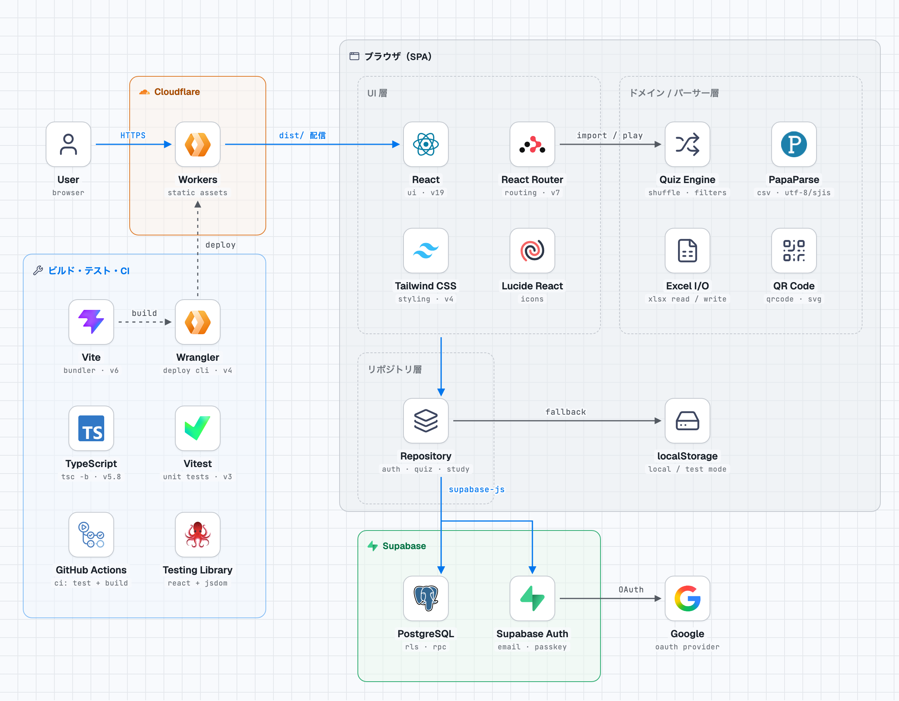

# Quiz Studio

CSV / Excel / JSON や生成AI（ChatGPT）の出力テキストから問題集を作成し、PC・スマートフォンで反復学習できるクイズ Web アプリケーションです。

- 本番 URL: https://quiz-studio.takutakus.com

## 主な機能

- **多様な問題集インポート**
  - **AI で問題集を作る（2ステップ導線）**: ChatGPT 用プロンプトをワンクリックでコピーし、出力テキスト（JSON / CSV、コードブロックや前後の会話文混在にも対応）を貼り付けるだけでファイルレスで登録
  - **ファイルアップロード**: `.csv`（UTF-8 / Shift-JIS 自動判別）、`.xlsx`（複数シート選択対応）、`.json` に対応（ドラッグ＆ドロップ可）
  - **テンプレート配布**: 書き方ガイド付き `.xlsx` / `.csv` テンプレートのダウンロードとサンプル CSV コピー
  - **2択〜4択・解説対応**: `choice3` / `choice4` / `explanation` は任意のため、◯✕問題・3択・4択を混在可能
- **学習・復習機能**
  - **一問一答モード / テストモード**: 即時正誤＆解説表示（スキップ・次へ自動スクロール対応）と、全問解答後の一括採点・振り返り
  - **シャッフル**: 問題順・選択肢順の個別 ON/OFF（Fisher-Yates）
  - **復習フィルター & 学習履歴**: 「すべての問題」「直近で間違えた問題」「正答率60%以下の問題」での出題、リザルトからの誤答再挑戦、ダッシュボードでの苦手問題数表示
  - **途中再開**: 問題集ごとに進行中セッション（問題順・選択肢順・解答状況）を自動保存
- **URL / QR コード共有**
  - 問題集ごとに共有リンクと SVG QR コードを発行（リンク再発行・共有停止対応）
  - 相手がリンクを開くと、認証後に問題集のコピーを自分のアカウントへ自動インポート
- **認証 & ローカル動作モード**
  - メール＋パスワード、Google OAuth、パスキー（WebAuthn）に対応
  - Supabase 環境変数が未設定の環境では自動的に `localStorage` モードへフォールバックし、バックエンド準備なしですぐに試用可能

---

## 技術スタック・アーキテクチャ

自前のアプリケーションサーバーを持たず、フロントエンド（SPA）が Repository 抽象化層を介して **Supabase（BaaS）** または **`localStorage`（ローカル/テスト用）** に接続するサーバーレス構成です。

<picture>
  <source media="(prefers-color-scheme: dark)" srcset="docs/architecture/stack-diagram-dark.png">
  
</picture>

> 図の正本は [`docs/architecture/stack-diagram.html`](docs/architecture/stack-diagram.html)（自己完結 HTML）。PNG はそこからヘッドレス Chromium で書き出しています。

### 使用ライブラリ・ツール一覧

| レイヤー | 技術・パッケージ | 用途 |
| --- | --- | --- |
| **UI / 言語** | React `19` / TypeScript `5.8` | コンポーネント構築と型安全な開発 |
| **ルーティング** | React Router `7` | `/login`, `/`, `/quiz/:quizId`, `/share/:token` |
| **スタイリング / アイコン** | Tailwind CSS `4` (`@tailwindcss/vite`) / Lucide React | レスポンシブ UI とアイコン |
| **CSV / Excel / JSON** | PapaParse / `read-excel-file` / `write-excel-file` | CSV（UTF-8/Shift-JIS）・Excel（複数シート）・JSON の解析とテンプレート生成 |
| **QR コード** | `qrcode` | 共有 URL の SVG QR コード生成・ダウンロード |
| **BaaS（認証・DB）** | Supabase (`@supabase/supabase-js` v2) | Auth（メール・Google OAuth・WebAuthn パスキー）、PostgreSQL、RLS、RPC |
| **ホスティング** | Cloudflare Workers Static Assets (`wrangler` v4) | 静的アセット配信、SPA フォールバック、カスタムドメイン |
| **ビルド / テスト** | Vite `6` / Vitest `3` / Testing Library / jsdom | 高速ビルド、単体・結合テスト（CI 自動実行） |

---

## クイックスタート（ローカル開発）

環境変数を設定しなくても、`localStorage` フォールバックによりそのまま起動・動作確認できます。

```bash
# 依存関係のインストール
npm install

# 開発サーバー起動 (http://localhost:5173)
npm run dev

# テスト実行
npm test

# プロダクションビルド
npm run build
```

---

## Supabase 連携セットアップ

本番相当の認証（メール / Google / パスキー）と PostgreSQL 永続化を使う場合は、`.env.example` をコピーして `.env.local` を作成します。

```bash
cp .env.example .env.local
```

```env
VITE_SUPABASE_URL=https://<project-ref>.supabase.co
VITE_SUPABASE_PUBLISHABLE_KEY=sb_publishable_xxx
```

> **Note:** `VITE_SUPABASE_URL` / `VITE_SUPABASE_PUBLISHABLE_KEY` が未設定の場合や `vitest` 実行時（`MODE === 'test'`）は、自動的に `localStorage` 実装に切り替わります。

### 1. データベースマイグレーション

`supabase/migrations/` の SQL をファイル名の昇順に Supabase Dashboard の SQL Editor または Supabase CLI で適用してください。

1. `supabase/migrations/20261113000000_create_quizzes_and_questions.sql`
   - `quizzes` / `questions` テーブル、所有者のみの RLS、`create_quiz_with_questions` RPC
2. `supabase/migrations/20261117000000_create_quiz_shares.sql`
   - `quiz_shares` / `quiz_share_imports` テーブル、共有管理・取得・インポート用 RPC（`enable_quiz_share`, `disable_quiz_share`, `regenerate_quiz_share`, `get_shared_quiz_summary`, `import_shared_quiz`）
3. `supabase/migrations/20261118000000_create_study_history.sql`
   - `question_stats` / `quiz_sessions` テーブル、所有者のみの RLS、`record_question_answer` RPC

### 2. Google OAuth ログイン設定（任意）

1. Google Cloud Console で OAuth 2.0 クライアント ID（ウェブアプリケーション）を作成し、承認済みリダイレクト URI に `https://<project-ref>.supabase.co/auth/v1/callback` を設定します。
2. Supabase Dashboard の `Authentication -> Providers -> Google` を有効化し、Client ID / Client Secret を入力します。
3. Supabase Dashboard の `Authentication -> URL Configuration` で、`Site URL` に公開 URL（ローカル確認のみなら `http://localhost:5173`）を設定し、`Redirect URLs` に公開 URL 配下（例: `https://<your-domain>/**`、`http://localhost:5173/**`）を追加します。

### 3. パスキー（WebAuthn）設定（任意）

1. Supabase Dashboard の `Authentication -> Passkeys` を有効化します。
2. WebAuthn Relying Party を設定します（例: Display Name `Quiz Studio` / Relying Party ID `<your-domain>` / Origins `https://<your-domain>`、ローカル時は `localhost`）。
3. メールアドレスまたは Google で一度ログインし、ダッシュボード右上の「パスキー設定」からパスキーを登録すると、次回以降 `/login` の「パスキーでログイン」が利用できます。

---

## Cloudflare Workers へのデプロイ

`wrangler.jsonc` の Static Assets 設定（`./dist` 配信 + `single-page-application` フォールバック）を用いて Cloudflare Workers へデプロイします。

> **Fork してご自身の環境へデプロイする場合:** `wrangler.jsonc` 内の `routes`（`quiz-studio.takutakus.com`）と `workers_dev` をご自身のドメインまたは `workers.dev` 向けに書き換えてください。

1. `.env.local` に本番用の `VITE_SUPABASE_URL` と `VITE_SUPABASE_PUBLISHABLE_KEY` が設定されていることを確認します（未設定のままビルドすると `localStorage` モードになります）。
2. Wrangler にログイン済みの状態で以下を実行します（内部で `npm run build` と `wrangler deploy` が実行されます）。

```bash
npm run deploy
```

---

## ディレクトリ構成

```text
.
├── .github/workflows/ci.yml   # GitHub Actions (Vitest + Vite build)
├── docs/                      # 機能仕様・AI-DLC Bolt 設計ドキュメント
├── src/
│   ├── components/            # モーダル・共通 UI コンポーネント
│   ├── context/               # AppContext (認証状態・Repository 注入)
│   ├── domain/                # パーサー (CSV/XLSX/JSON)、出題エンジン、復習ロジック
│   ├── lib/                   # Supabase クライアント、共有リダイレクト、ユーティリティ
│   ├── pages/                 # LoginPage / DashboardPage / QuizPlayPage / ShareImportPage
│   └── repositories/          # Supabase / localStorage リポジトリ実装とインターフェース
├── supabase/migrations/       # PostgreSQL テーブル・RLS・RPC マイグレーション
├── .env.example               # 環境変数テンプレート
└── wrangler.jsonc             # Cloudflare Workers Static Assets 設定
```

## ライセンス

[MIT License](./LICENSE)
