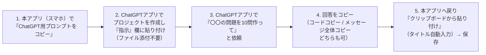

# 要件定義書：ChatGPT プロジェクト連携・テキスト貼り付けインポート機能

## 1. 目的・ゴール
スマートフォンで ChatGPT アプリ等を利用しているユーザーが、**ChatGPT アプリと本アプリ（Quiz Studio）の2つだけ** を使い、**ファイルのダウンロード・保存や他アプリ（Excel・ファイル管理アプリ等）を一切経由せずに**、問題集の作成から登録までを完結できるようにする。

1. **ファイルレス・2アプリ完結の登録導線**：ChatGPT の回答をコピーして本アプリに貼り付けるだけで、タイトル自動入力・形式検証・登録まで完了する。
2. **プロンプト単体で完結する ChatGPT プロジェクト連携**：テンプレートファイルのダウンロードやプロジェクトへのファイル添付を不要とし、本アプリからコピーする「指示（Instructions）」プロンプトのみで正確な形式を出力させる。
3. **スマホ特有のコピー操作への耐性**：ChatGPT アプリの「コードをコピー」だけでなく、回答下部の「コピー」ボタンで会話の前置き・後書きごとコピーした場合でも、テキスト内のコードブロックを自動抽出して取り込めるようにする。

> [!NOTE]
> PC 向けの既存機能（`.csv` / `.xlsx` ファイルアップロードやテンプレートダウンロード）はそのまま維持し、新たに `.json` ファイル対応およびスマホ最適化された「テキストを貼り付け」インポートを追加します。

---

## 2. スマホ完結の運用フロー（ダウンロード不要・2アプリのみ）



### 2.1 ユーザー操作（ファイル保存ゼロ）
1. **初回セットアップ（1回のみ）**：
   - 本アプリのアップロードモーダル（または専用ボタン）から **「ChatGPT用プロンプトをコピー」** をタップする。
   - ChatGPT アプリを開き、新しいプロジェクトの **「指示（Instructions）」** に貼り付けて保存する（テンプレートファイルのダウンロード・添付は不要）。
2. **問題集の作成〜登録（毎回3ステップ）**：
   - ChatGPT アプリのプロジェクト内で「〇〇試験の問題を15問作って」「この内容を4択クイズにして」などと依頼する。
   - ChatGPT が出力した回答を「コードをコピー」または回答全体の「コピー」ボタンでコピーする。
   - 本アプリに戻り、「テキストを貼り付け」画面で **「クリップボードから貼り付け」**（または入力欄へペースト）を行い、自動入力されたタイトルと問題数を確認して **「保存」** をタップする。

---

## 3. 機能要件詳細（アプリ側拡張）

### 3.1 アップロードモーダル（`CsvUploadModal`）の拡張

#### ① 入力方法のタブ切替（スマホ操作優先）
モーダル内のデータ入力エリアを以下の2つのモード（タブ）で切り替えられるようにする。
- **テキストを貼り付け**：ChatGPT アプリ等からコピーしたテキスト（JSON / CSV）を直接貼り付けて読み込む。スマホでそのまま使えるよう、ワンタップで呼び出せる見やすい位置に配置する（端末や状況に応じて使いやすいタブ構成とする）。
- **ファイルをアップロード**（従来の `.csv` / `.xlsx` に加え `.json` にも対応）：PC等で作成したファイルをドラッグ＆ドロップまたはファイル選択で取り込む。

#### ② スマホ向け貼り付け補助 & コードブロック抽出
- **ワンタップ「クリップボードから貼り付け」ボタン**：
  - テキストエリアの上部に「クリップボードから貼り付け」ボタンを配置し、`navigator.clipboard.readText()` でクリップボード内容を即座にテキストエリアへ反映・解析する。
  - ブラウザの権限設定や非対応環境で自動読み取りできない場合は、エラーで止めずに「下の入力欄を長押しして『ペースト』してください」とガイドを表示し、通常のペースト操作でそのまま取り込めるようにする。
- **前後の会話文・コードフェンスの自動除去（抽出ロジック）**：
  - スマホ版 ChatGPT アプリでメッセージ全体をコピーすると、コードブロックの前後に「承知しました。以下が出力です。」などの解説文が含まれる場合がある。
  - テキスト全体をそのまま解析して失敗（または冒頭に非データ行が含まれる）前に、以下の優先順でデータ本体を抽出する：
    1. Markdown コードフェンス（```` ```json ... ``` ````、```` ```csv ... ``` ````、```` ``` ... ``` ````）がテキスト内に含まれていれば、その中身を優先抽出する（複数ある場合は最初に有効データらしいブロック、または最初のブロックを使用）。
    2. コードフェンスがない場合は、テキスト全体（前後空白トリム済み）をそのまま対象とする。
- **形式の自動判定**：
  - 抽出したテキストの先頭文字が `[` または `{` の場合は **JSON** として解析し、それ以外の場合は **CSV**（`parseAndValidateCsv`）として解析する。
- **即時フィードバック**：
  - 貼り付け・入力に応じて即時に解析とバリデーションを実行し、「◯問の問題を読み込みました。」または行／問題番号付きのエラー一覧を表示する。
  - 空欄時はエラーを出さず待機状態とする。

#### ③ モバイル表示への配慮
- スマホの小さな画面（縦画面）でも **「クリップボードから貼り付け」・テキスト入力欄・問題件数プレビュー・「保存」ボタン** がスクロール負荷なく操作できるよう、テンプレート詳細ガイドやサンプル表は折りたたみ（`<details>` / アコーディオン）等にしてコンパクトに収める。

#### ④ JSON 形式の仕様（テキスト貼り付け & `.json` ファイル共通）
- **受け付ける構造**：
  1. **オブジェクト形式（推奨・タイトル同梱）**：`{ title?: string, questions: QuestionInput[] }`
  2. **配列形式**：`QuestionInput[]`
- **各要素（`QuestionInput`）のプロパティ**：

| キー | 必須/任意 | 許容される型・値 | 備考 |
| --- | --- | --- | --- |
| `question` | **必須** | `string`（空白のみ不可） | 前後空白はトリム |
| `choice1` | **必須** | `string`（空白のみ不可） | 前後空白はトリム |
| `choice2` | **必須** | `string`（空白のみ不可） | 前後空白はトリム |
| `choice3` | 任意 | `string \| null \| undefined` | 省略・空文字・`null` は空欄扱い |
| `choice4` | 任意 | `string \| null \| undefined` | 入力時は `choice3` も必須 |
| `answer` | **必須** | `number` (`1`〜`4`) または `string` (`"1"`〜`"4"`) | 整数 `1`〜`4` に変換し、対応選択肢が空欄ならエラー |
| `explanation` | 任意 | `string \| null \| undefined` | 省略・空文字・`null` は解説なし扱い |

- **共通バリデーション**：抽出した行データを既存の `validateQuestionRows` に通すことで、CSV / Excel / JSON のすべてで同一の検証ルール・日本語エラーメッセージ（何問目＝`rowNumber` かを含む）を保証する。
- **タイトル自動補完（スマホでの文字入力を最小化）**：
  - JSON オブジェクトに有効な `title` が含まれている場合、**タイトル入力欄が未入力（空文字）のときに限り** `title` を自動入力する（ユーザーが手動で入力・編集済みの場合は上書きしない）。
  - `.json` ファイルアップロード時は、ファイル名から `.json` を除いた文字列、または JSON 内の `title` を補完する。
- **構文エラー時**：`JSON.parse` に失敗した場合や、配列 / `questions` 配列が見つからない場合は、保存をブロックして日本語のエラーメッセージを表示する。

#### ⑤ タブ切替・モーダル初期化時の状態管理
- タブを切り替えた場合、現在アクティブなタブの入力内容のみを有効な解析結果として扱う（非アクティブなタブの古いエラーや問題リストが残らないようにする）。
- モーダルを閉じて再度開いたとき、または保存完了時は入力テキスト・選択ファイル・タイトル・タブ状態を初期状態へリセットする。

### 3.2 「ChatGPT プロジェクト用プロンプトをコピー」機能
- モーダル内に **「ChatGPT用プロンプトをコピー」** ボタンを配置する（スマホでもすぐ押せる位置に配置し、テンプレート詳細を折りたたんでいても見えるようにする）。
- ボタンを押すと、クリップボードへ **第4章の指示テンプレート全文（`CHATGPT_PROJECT_PROMPT`）** をコピーし、「コピーしました」のフィードバックを2秒間表示する。
- クリップボード API が利用できない環境でもクラッシュせず、プロンプト本文を開いて手動コピーできるフォールバック導線を備える。

---

## 4. ChatGPT プロジェクト用 指示（Instructions）テンプレート

プロンプト単体で完結（ファイル添付不要）し、スマホの ChatGPT アプリから1タップでコピー＆貼り付けできるように、原則 **タイトル付きの単一 JSON コードブロック** で出力させる設計とする（JSON の方がカンマ・改行・記号のエスケープ崩れが起きにくく、タイトルも自動入力できるため）。

```text
あなたは「Quiz Studio」用の問題集データを作成するアシスタントです。
ユーザーが指定したテーマ・資料・画像・メモをもとに、学習用の選択式問題を作成し、
スマホやPCからそのままアプリへコピー＆ペーストで登録できる形式で出力してください。

【出力ルール（厳守）】
1. 出力は原則として、以下の構造の JSON コードブロック（```json ... ```）を1つだけ出力すること。
   余計な前置きや後書きは書かず、コードブロックのみを出力すること（スマホでそのままコピーしやすくするため）。
2. JSON の構造：
   {
     "title": "問題集の簡潔なタイトル",
     "questions": [
       {
         "question": "問題文",
         "choice1": "選択肢1",
         "choice2": "選択肢2",
         "choice3": "選択肢3（2択の場合は null または空文字）",
         "choice4": "選択肢4（2〜3択の場合は null または空文字）",
         "answer": 1,
         "explanation": "解説文（不要な場合は空文字または null）"
       }
     ]
   }
3. 各項目の制約：
   - title: 問題集のタイトル（1文字以上）
   - question, choice1, choice2: 必須（空文字不可）
   - choice3, choice4: 任意。ただし choice4 を入れる場合は choice3 も必ず入力すること（2択は choice3/4 を空、3択は choice4 のみ空）
   - answer: 正解番号。半角整数 1〜4 のみ（空欄の選択肢番号は指定不可）
   - explanation: 任意（解説が不要なら空文字または null）
4. ユーザーから特別に「CSV形式で」と指定された場合のみ、1行目ヘッダーを
   question,choice1,choice2,choice3,choice4,answer,explanation
   とした CSV コードブロック（```csv ... ```）1つだけを出力すること。
```

---

## 5. スコープ外（本機能で扱わないこと）
- **OpenAI API / ChatGPT API との直接通信**：アプリ側での API キー設定やサーバー経由の AI 問題生成は行わない（ユーザー自身の ChatGPT アプリ上で問題を作成し、コピペで取り込む運用とする）。
- **OS ネイティブの共有シート / カスタム URL スキーム連携**：PWA やネイティブアプリラッパーを前提としないため、OS 固有の共有メニュー連携はスコープ外とし、iOS / Android 双方で動作するクリップボード経由の貼り付けを採用する。
- **画像・LaTeX 数式レンダリング**：既存のテキスト仕様と同様、問題文・選択肢・解説はプレーンテキストを対象とする。
