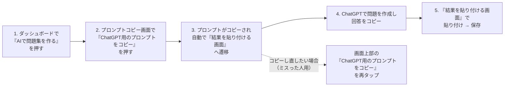

# 要件定義書：AIで問題集を作る（ChatGPT連携・テキスト貼り付けインポート）

> 最終更新: 2026-11-18（ダッシュボードの「AIで問題集を作る」ボタン新設、プロンプトコピーから結果貼り付け画面へのステップ遷移、および貼り付け画面上部の再コピーボタン配置を反映）

## 1. 目的・ゴール
スマートフォンやPCで ChatGPT 等を利用しているユーザーが、**ダッシュボードから迷わず直感的に「AIで問題集を作る」導線に入れるようにし**、プロンプトのコピーから生成結果の貼り付け・登録までをステップ形式でスムーズに完結できるようにする。

1. **ダッシュボード上の明確な入口（「AIで問題集を作る」ボタン）**：
   - 従来の「アップロードモーダル内の奥にあるプロンプトコピーボタン」を改め、ダッシュボード上部のアクション領域に **「AIで問題集を作る」** ボタンを配置する。
2. **迷わない2ステップ遷移（プロンプトコピー → 結果貼り付け画面）**：
   - 「AIで問題集を作る」を押すと、まず **ステップ1：プロンプトコピー画面**（「ChatGPT用のプロンプトをコピー」ボタン）を表示する。
   - 「ChatGPT用のプロンプトをコピー」ボタンを押すと、クリップボードにプロンプトをコピーしたうえで、自動的に **ステップ2：結果を貼り付ける画面** へ遷移（移管）する。
3. **貼り付け画面上部での再コピー導線（ミスった人用）**：
   - 結果を貼り付ける画面の上部にも **「ChatGPT用のプロンプトをコピー」** ボタンを常設し、途中で別のテキストをコピーしてしまった人やコピーし直したい人が画面を戻らずにすぐ再コピーできるようにする。
4. **ファイルレス・スマホ耐性の維持**：
   - テンプレートファイルのダウンロードや添付は不要（プロンプト単体で完結）。
   - ChatGPT の「コードをコピー」だけでなく、回答全体の「コピー」（前後の会話文を含む）でもコードブロックを自動抽出して取り込める。

> [!NOTE]
> PC 向けの既存機能（`.csv` / `.xlsx` / `.json` ファイルアップロードやテンプレートダウンロード）は「新規問題集アップロード」側から引き続き利用できます。

---

## 2. 画面遷移・ユーザー操作フロー



### 2.1 標準フロー（初回・毎回プロンプトを使う場合）
1. ダッシュボード上部の **「AIで問題集を作る」** ボタンを押す。
2. **ステップ1（プロンプトコピー画面）** が開くので、**「ChatGPT用のプロンプトをコピー」** ボタンを押す。
   - クリップボードに ChatGPT 用プロンプト（第4章）がコピーされ、画面が自動的に **ステップ2（結果を貼り付ける画面）** に切り替わる。
3. ChatGPT（アプリまたはWeb）を開き、コピーしたプロンプトを貼り付けて（またはプロジェクトの「指示」に設定して）問題作成を依頼し、出力された回答をコピーする。
4. 本アプリの **ステップ2（結果を貼り付ける画面）** に戻り、結果を貼り付けて（または「クリップボードから貼り付け」を押して）**「保存」** を押す。
   - ※途中でプロンプトのコピーをやり直したくなった場合は、**結果を貼り付ける画面の上部にある「ChatGPT用のプロンプトをコピー」ボタン** をそのまま押せる。

### 2.2 スキップ導線（すでにChatGPTプロジェクト設定済み・回答コピー済みの場合）
- すでに ChatGPT 側のプロジェクト指示にプロンプトを設定済みで、手元に生成結果があるユーザーのために、ステップ1画面には補助リンクとして **「すでに結果をお持ちの方はこちら（貼り付け画面へ）」** も用意し、プロンプトを上書きコピーせずにステップ2へ進めるようにする。

---

## 3. 機能要件詳細

### 3.1 ダッシュボードのボタン配置（変更点）

ダッシュボード上部のアクションボタン領域（および問題集0件時の空状態エリア）を以下のように構成する。

- **上部のボタン領域**：
  - **「AIで問題集を作る」ボタン**（`Sparkles` アイコン付き）：押下すると「AIで問題集を作る」モーダル（またはアップロードモーダルのAI作成ステップ1）を開く。
  - **「新規問題集アップロード」ボタン**（`Plus` アイコン付き）：従来通り `.csv` / `.xlsx` / `.json` ファイルのアップロード画面を開く。
  - **「テンプレートExcel」「テンプレートCSV」ボタン**：ダッシュボード上部（またはファイルアップロードモーダル内）からテンプレートを取得できる（※ダッシュボード上部に残すか、モーダル内へ集約するかはレイアウト方針に従う。デフォルトでは既存テスト・導線との互換性を保ちつつ「AIで問題集を作る」を目立つ位置に配置する）。
- **問題集が0件のとき（空状態）**：
  - 空状態カード内にも **「AIで問題集を作る」** ボタンを配置し、初回ユーザーがすぐAI作成フローを開始できるようにする。

---

### 3.2 「AIで問題集を作る」2ステップ画面仕様

#### ステップ1：プロンプトコピー画面（初期画面）
「AIで問題集を作る」ボタンを押した直後に表示される画面。
- **表示要素**：
  1. **手順の簡潔な案内**：
     - 「① 下のボタンで ChatGPT 用のプロンプトをコピーします」
     - 「② ChatGPT に貼り付けて問題を作ってもらい、出力結果を次の画面に貼り付けます」
  2. **メインボタン：「ChatGPT用のプロンプトをコピー」**：
     - 大きく押しやすいプライマリボタンとして配置する。
     - 押下時の動作：
       - `CHATGPT_PROJECT_PROMPT` をクリップボードにコピーする。
       - コピー完了と同時に **ステップ2（結果を貼り付ける画面）へ自動遷移** する（遷移後の画面上部で「プロンプトをコピーしました」の通知またはボタン状態を表示する）。
       - 万一ブラウザ環境により `navigator.clipboard.writeText` が失敗した場合でも、ステップ2へ遷移したうえでプロンプト全文の手動コピー欄を開く（またはその場で手動コピー欄を表示して次に進めるようにする）。
  3. **プロンプト内容の確認（任意展開）**：
     - 「プロンプトの内容を確認する」トグルで、コピーされるプロンプト本文を確認できる。
  4. **スキップ補助導線**：
     - 「すでに生成結果をお持ちの場合はこちら（貼り付け画面へ進む）」ボタン／リンクで、クリップボードを上書きせずにステップ2へ遷移できる。

#### ステップ2：結果を貼り付ける画面（遷移後画面）
ステップ1で「ChatGPT用のプロンプトをコピー」を押した後に移管（遷移）する画面。
- **画面上部：再コピー用バー（ミスった人用）**：
  - 画面の最上部（問題集タイトル欄や貼り付け欄よりも上）に、**「ChatGPT用のプロンプトをコピー」** ボタンを配置する。
  - 誤って別のテキストをコピーしてしまった場合や、もう一度プロンプトをコピーしたい場合に、前の画面へ戻ることなくワンタップで再コピーできる。
  - 押下時はクリップボードへ `CHATGPT_PROJECT_PROMPT` をコピーし、「コピーしました」のフィードバックを2秒間表示する（クリップボードAPI非対応時はプロンプト表示欄を展開する）。
- **問題集タイトル入力欄**：
  - 任意のタイトルを入力可能。JSON 内に `title` が含まれており、タイトル欄が空の場合は自動補完する。
- **結果の貼り付けエリア**：
  - **「クリップボードから貼り付け」ボタン**：`navigator.clipboard.readText()` でクリップボードのテキストを即座に読み取って解析する（非対応・拒否時は「下の入力欄を長押しして『ペースト』してください」と案内する）。
  - **テキスト入力欄（`<textarea>`）**：ChatGPT の出力（JSON / CSV）を直接ペーストできる。
  - **「入力をクリア」ボタン**：入力がある場合にワンタップでクリアできる。
- **解析結果・バリデーション表示**：
  - 貼り付けと同時にコードブロック抽出・形式判定・バリデーションを実行し、「◯問の問題を読み込みました。」またはエラー一覧（`n問目: ...` / `n行目: ...`）を表示する。
- **フッターボタン**：
  - 「キャンセル」ボタン、「保存」ボタン（タイトル入力済み・有効な問題1問以上・エラー0件のとき活性）。

---

### 3.3 コードブロック抽出・JSON/CSV 解析仕様（既存仕様の継承）

1. **前後の会話文・コードフェンスの自動除去**：
   - Markdown コードフェンス（```` ```json ... ``` ````、```` ```csv ... ``` ````、```` ``` ... ``` ````）を走査し、閉じフェンス欠落時も含めてコードブロック本文を抽出する。
   - 複数コードブロックがある場合は、JSON または CSV として有効な最初のブロックを採用する。
   - コードフェンスがない場合はテキスト全体（前後空白トリム済み）を解析対象とする。
2. **形式の自動判定**：
   - 抽出後の先頭文字が `[` または `{` なら JSON、それ以外は CSV として解析する。
3. **JSON 形式仕様**：
   - `{ title?: string, questions: QuestionInput[] }`（推奨）または `QuestionInput[]` を受け付ける。
   - 各要素は `question`, `choice1`, `choice2`, `choice3?`, `choice4?`, `answer` (`1`〜`4`), `explanation?` を持ち、CSV / Excel と共通の `validateQuestionRows` で検証する。

---

## 4. ChatGPT 用プロンプト（`CHATGPT_PROJECT_PROMPT`）

```text
あなたは「Quiz Studio」用の問題集データを作成するアシスタントです。
ユーザーが指定したテーマ・資料・画像・メモをもとに、学習用の選択式問題を作成し、
スマホやPCからそのままアプリへコピー＆ペーストで登録できる形式で出力してください。

【出力ルール（厳守）】
1. 出力は原則として、以下の構造の JSON コードブロック（```json ... ```）を1つだけ出力すること。
   余計な前置きや後書きは書かず、コードブロックのみを出力すること（スマホでそのままコピーしやすくするため）。
2. JSON の構造：
   {
     "title": "問題集の簡潔なタイトル",
     "questions": [
       {
         "question": "問題文",
         "choice1": "選択肢1",
         "choice2": "選択肢2",
         "choice3": "選択肢3（2択の場合は null または空文字）",
         "choice4": "選択肢4（2〜3択の場合は null または空文字）",
         "answer": 1,
         "explanation": "解説文（不要な場合は空文字または null）"
       }
     ]
   }
3. 各項目の制約：
   - title: 問題集のタイトル（1文字以上）
   - question, choice1, choice2: 必須（空文字不可）
   - choice3, choice4: 任意。ただし choice4 を入れる場合は choice3 も必ず入力すること（2択は choice3/4 を空、3択は choice4 のみ空）
   - answer: 正解番号。半角整数 1〜4 のみ（空欄の選択肢番号は指定不可）
   - explanation: 任意（解説が不要なら空文字または null）
4. ユーザーから特別に「CSV形式で」と指定された場合のみ、1行目ヘッダーを
   question,choice1,choice2,choice3,choice4,answer,explanation
   とした CSV コードブロック（```csv ... ```）1つだけを出力すること。
```

---

## 5. スコープ外（本機能で扱わないこと）
- **OpenAI API / ChatGPT API との直接通信**：アプリ側での API キー設定やサーバー経由の AI 問題生成は行わない。
- **OS ネイティブの共有シート / カスタム URL スキーム連携**：クリップボード経由のコピー＆ペーストで完結させる。
- **画像・LaTeX 数式レンダリング**：問題文・選択肢・解説はプレーンテキストを対象とする。
