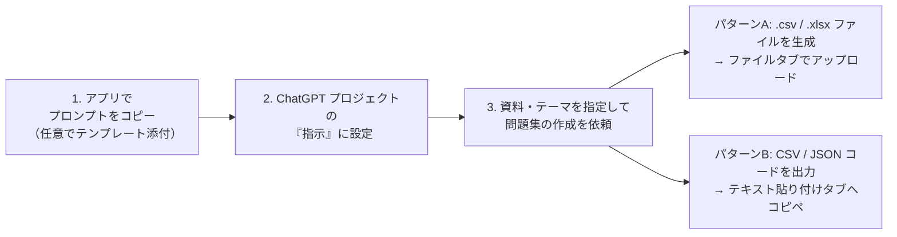

# 要件定義書：ChatGPT プロジェクト連携・テキスト貼り付けインポート機能

## 1. 目的・ゴール
既存の「CSV Quiz Studio」において、ユーザーが **ChatGPT の「プロジェクト」機能** を活用して問題集を作成し、最小の手間でそのまま本アプリへ取り込めるようにする。

1. **ChatGPT プロジェクト用プロンプトの提供**：本アプリの列定義・バリデーションルールに完全準拠した出力を生成させる「プロジェクトの指示（Instructions）」文面をアプリ内からワンクリックでコピーできるようにする。
2. **テキスト貼り付け（ペースト）インポート**：ファイル保存の手間を省き、ChatGPT がチャット上に出力した **CSV テキスト** または **JSON テキスト** をそのまま貼り付けて問題集を作成できるようにする。
3. **JSON 形式対応（貼り付け・`.json` ファイル）**：CSV のカンマ・改行・ダブルクォートのエスケープ崩れを避けたいケースやタイトル自動設定に対応するため、JSON 形式での取り込みにも対応する。

> [!NOTE]
> 既存の `.csv` / `.xlsx` ファイルアップロードおよびテンプレート（`quiz_template.csv` / `quiz_template.xlsx`）のダウンロード導線は維持し、ファイル生成（ChatGPT Code Interpreter）とテキスト貼り付けの両方に対応します。

---

## 2. ChatGPT プロジェクトでの運用フロー



### 2.1 プロジェクト設定手順（ユーザー運用）
1. ChatGPT で専用プロジェクトを作成する。
2. アップロードモーダルの「ChatGPT用プロンプトをコピー」ボタンから指示文をコピーし、プロジェクトの **指示（Instructions）** に貼り付ける。
3. （任意）アプリからダウンロードした `quiz_template.xlsx` または `quiz_template.csv` をプロジェクトの **ファイル** に添付する。
4. プロジェクト内のチャットで教材 PDF や学習範囲を渡し、「この範囲から4択問題を20問作って」と依頼する。

---

## 3. 機能要件詳細（アプリ側拡張）

### 3.1 アップロードモーダル（`CsvUploadModal`）の拡張

#### ① 入力方法のタブ切替
モーダル内のデータ入力エリアを以下の2つのモード（タブ）で切り替えられるようにする。
- **ファイルをアップロード**（デフォルト）：従来の `.csv` / `.xlsx` に加え `.json` ファイルの選択・ドラッグ＆ドロップを受け付ける。
- **テキストを貼り付け**：ChatGPT 等が出力した CSV または JSON テキストを直接貼り付ける `<textarea>` を表示する。

#### ② テキスト貼り付け時の挙動
- テキストエリアへの入力・貼り付け（`onChange` / `onPaste`）に応じて即時にパース＆バリデーションを実行し、ファイルアップロード時と同じ形式で以下を表示する：
  - 成功時：「◯問の問題を読み込みました。」サマリー表示と保存ボタンの有効化（タイトルが入力済みの場合）。
  - 失敗時：エラー件数と行番号／問題番号ごとのエラー理由一覧（保存ボタン無効化）。
- 空欄時はエラーを出さず待機状態とする。
- **コードフェンスの自動除去**：ChatGPT が ```` ```csv ... ``` ```` や ```` ```json ... ``` ```` や ```` ``` ... ``` ```` のように Markdown コードブロックごとコピーされた場合でも、前後のコードフェンス行を自動で取り除いて解析する。
- **形式の自動判定**：コードフェンス除去・前後空白トリム後の先頭文字が `[` または `{` の場合は **JSON** として解析し、それ以外の場合は **CSV**（`parseAndValidateCsv`）として解析する。

#### ③ JSON 形式の仕様（テキスト貼り付け & `.json` ファイル共通）
- **受け付ける構造**：
  1. **配列形式**：`QuestionInput[]`
  2. **オブジェクト形式（タイトル同梱可）**：`{ title?: string, questions: QuestionInput[] }`
- **各要素（`QuestionInput`）のプロパティ**：

| キー | 必須/任意 | 許容される型・値 | 備考 |
| --- | --- | --- | --- |
| `question` | **必須** | `string`（空白のみ不可） | 前後空白はトリム |
| `choice1` | **必須** | `string`（空白のみ不可） | 前後空白はトリム |
| `choice2` | **必須** | `string`（空白のみ不可） | 前後空白はトリム |
| `choice3` | 任意 | `string \| null \| undefined` | 省略・空文字・`null` は空欄扱い |
| `choice4` | 任意 | `string \| null \| undefined` | 入力時は `choice3` も必須 |
| `answer` | **必須** | `number` (`1`〜`4`) または `string` (`"1"`〜`"4"`) | 整数 `1`〜`4` に変換し、対応選択肢が空欄ならエラー |
| `explanation` | 任意 | `string \| null \| undefined` | 省略・空文字・`null` は解説なし扱い |

- **共通バリデーション**：抽出した行データを既存の `validateQuestionRows` に通すことで、CSV / Excel / JSON のすべてで同一の検証ルール・日本語エラーメッセージ（何問目＝`rowNumber` かを含む）を保証する。
- **タイトル自動補完**：
  - JSON オブジェクトに `title`（空でない文字列）が含まれている場合、**タイトル入力欄が未入力（空文字）のときに限り** `title` を自動入力する（ユーザーが既に入力済みのタイトルは上書きしない）。
  - `.json` ファイルをアップロードした場合、ファイル名から `.json` を除いた文字列を仮タイトルとして入力し、JSON 内に有効な `title` が含まれていればそちらを優先してよい（ただしユーザーが手動編集後は上書きしない）。
- **構文エラー時**：`JSON.parse` に失敗した場合や、配列/`questions` 配列が見つからない場合は、保存をブロックして「JSONの形式が正しくありません。カッコやカンマの過不足を確認してください。」等の日本語エラーを表示する。

#### ④ タブ切替・モーダル初期化時の状態管理
- タブを切り替えた場合、現在アクティブなタブの入力内容のみを有効な解析結果として扱う（もう片方のタブの古いエラーや問題リストが残らないようにする）。
- モーダルを閉じて再度開いたとき、または保存完了時は入力テキスト・選択ファイル・タイトル・タブ状態を初期状態へリセットする。

### 3.2 「ChatGPT プロジェクト用プロンプトをコピー」機能
- モーダル内の「鋳型（テンプレート）と書き方」セクション（または専用の「AI（ChatGPT）で作る」案内ブロック）に、**「ChatGPT用プロンプトをコピー」** ボタンを配置する。
- ボタンを押すと、クリップボードへ **第4章の指示テンプレート全文（`CHATGPT_PROJECT_PROMPT`）** をコピーし、「コピーしました」の視覚的フィードバックを2秒間表示する。
- クリップボード API が利用できない環境（非 HTTPS や権限拒否など）ではクラッシュせず、プロンプト全文を確認・手動コピーできるフォールバック表示（またはエラー通知）を行えるようにする。

---

## 4. ChatGPT プロジェクト用 指示（Instructions）テンプレート

アプリからコピーするプロンプトは、以下の仕様を満たす定数として管理する。

```text
あなたは「CSV Quiz Studio」用の問題集データを作成するアシスタントです。
ユーザーが指定したテーマ・資料・PDF・メモをもとに、学習用の選択式問題を作成し、
アプリへそのまま取り込める形式で出力してください。

【出力形式（以下のいずれか）】
- ファイルで渡す場合：UTF-8（BOM付き）の `.csv` ファイル、またはシート名「問題データ」の `.xlsx` ファイル（Code Interpreter 等で生成）
- チャットで出力してコピペさせる場合：CSV または JSON のコードブロック

【厳守する列・項目仕様】
1. ヘッダー（CSV/Excel の1行目）は次の7列をこの正確な英語名で必ずすべて含めること（空欄の列があってもヘッダーは省略しない）：
   question,choice1,choice2,choice3,choice4,answer,explanation

2. 各項目のルール：
   - question（必須）: 問題文（空欄不可）
   - choice1（必須）: 選択肢1（空欄不可）
   - choice2（必須）: 選択肢2（空欄不可）
   - choice3（任意）: 選択肢3（2択問題にする場合は空欄にする）
   - choice4（任意）: 選択肢4（choice4 を入力する場合は choice3 も必ず入力すること）
   - answer（必須）: 正解番号。半角数字の 1〜4 のみ（空欄の選択肢番号は指定不可）
   - explanation（任意）: 解説文（不要なら空欄可）

3. フォーマット別の注意点：
   - CSV：カンマ `,`・改行・ダブルクォート `"` を含むセルは RFC 4180 形式で正しくクォートすること。
   - JSON：問題数が多い場合や文章に記号・改行が多い場合は、エスケープ崩れを防ぐため `{ "title": "問題集タイトル", "questions": [ ... ] }` 形式の JSON コードブロックで出力すること。
   - 出力とあわせて、問題集タイトル案も提示すること。
```

---

## 5. スコープ外（本機能で扱わないこと）
- **OpenAI API / ChatGPT API との直接通信**：アプリ側での API キー設定やサーバー経由の AI 問題生成は行わない（ユーザー自身の ChatGPT プロジェクト上で問題を作成し、ファイルまたはコピペで取り込む運用とする）。
- **ChatGPT 側への双方向連携**：学習結果の ChatGPT への自動送信や OAuth 連携は行わない。
- **画像・LaTeX 数式レンダリング**：既存のテキスト仕様と同様、問題文・選択肢・解説はプレーンテキストを対象とする。
