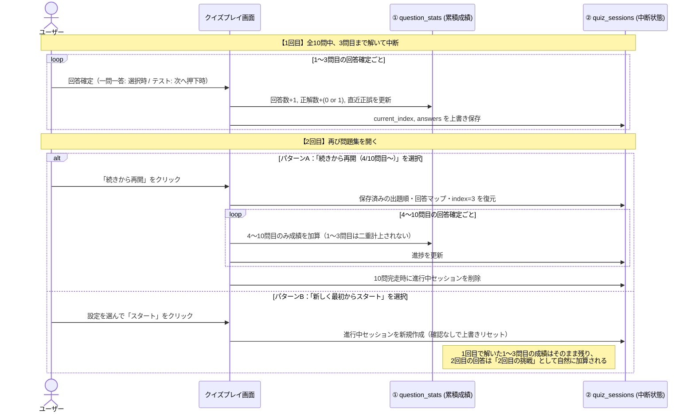

# 要件定義書：学習履歴・苦手復習 & 途中再開機能

> 最終更新: 2026-11-18（レビューでの決定事項を反映：正答率は全回答の累積、中断セッションは確認なしで上書き、ダッシュボードの全体正答率は表示しない、RLSでの所有者チェック、保存失敗時の扱い、スコープ外の明記）

## 1. 目的・ゴール
既存の「CSV Quiz Studio」に対して、ユーザーの学習効率を高める以下の2機能を追加する。

1. **正誤記録・苦手復習機能**：1問回答するごとに正解・不正解をDBへ記録し、**「直近で間違えた問題」**や**「正答率60%以下の問題」**に絞って復習できるようにする。
2. **途中中断・再開（レジューム）機能**：問題集の途中で離脱した場合でも、次回アクセス時に中断した箇所からそのまま再開できるようにする。

---

## 2. アーキテクチャ・データ整合性設計

> [!IMPORTANT]
> **「1回目を途中でやめて、2回目を最初から全部やった場合」の挙動と整合性**
>
> **「① 問題ごとの累積成績（`question_stats`）」** と **「② 進行中セッション状態（`quiz_sessions`）」** の2テーブル（LocalStorageでは2ストア）に分離して1問ごとに保存します。



---

## 3. 機能要件詳細

### 3.1 1問ごとの正誤記録・進捗保存仕様
- **一問一答モード (`one_by_one`)**：
  - 選択肢をクリックしてその問題の正誤が確定したタイミングで、即時DBへ保存する：
    1. `question_stats`：対象問題の `attempts_count` を `+1`、正解なら `correct_count` を `+1`、`last_is_correct` を更新。
    2. `quiz_sessions`：現在の `answers` マップおよび次に進むべきインデックス（`current_index`）を更新。
- **テストモード (`test`)**：
  - 画面上は従来通り全問終了後まで正誤・解説を隠すが、ユーザーが選択肢を選んで **「次へ（または結果を見る）」を押したタイミング** で1問ごとに裏で `question_stats` と `quiz_sessions` を即時保存する。
- **完走時の処理**：
  - 最終問題まで回答しリザルト画面（`phase === 'result'`）に遷移した時点で、その問題集の進行中セッション（`quiz_sessions`）を削除する。
  - そのため、リザルト画面の「もう一度解く」「間違えた問題だけ解く」から始めても、上書きされる中断セッションは存在しない。
- **保存失敗時の処理**：
  - 通信エラー等で `question_stats` / `quiz_sessions` の保存に失敗しても、プレイは止めずにそのまま続行する。
  - 画面上には「学習記録を保存できませんでした」程度の控えめな警告を表示するにとどめ、確認ダイアログやエラー画面は出さない。
  - 自動リトライは行わない（同じ回答の二重加算を避けるため）。失敗した回答の成績は記録されないものとする。

### 3.2 復習フィルター（出題対象の絞り込み）
クイズ開始画面（`/quiz/:quizId` の Setup フェーズ）に「出題対象」セクションを追加し、各条件の該当問題数をバッジ表示する（該当が0問の選択肢は非活性化する）。

| 出題対象フィルター | 判定ロジック |
| --- | --- |
| **すべての問題**（デフォルト） | 問題集内の全問題を出題 |
| **直近で間違えた問題** | 回答履歴があり、かつ `last_is_correct === false` の問題 |
| **正答率60%以下の問題** | 1回以上回答しており（`attempts_count >= 1`）、かつ `(correct_count / attempts_count) * 100 <= 60` の問題 |

- **正答率は全回答の累積**で計算する（直近N回などの期間による区切りは設けない）。最近の状態は「直近で間違えた問題」フィルターで拾う役割分担とする。
- **一度も回答していない問題**は、「直近で間違えた問題」「正答率60%以下の問題」のどちらの対象にもならない。「未回答の問題」フィルターは設けない。
- また、リザルト画面の「間違えた問題だけ解く」から再挑戦を開始した場合も、対象問題リストで新しい `quiz_sessions` を開始し、1問ごとに成績・中断状態を保存する。
- 選んだ出題対象（すべて / 直近で間違えた / 正答率60%以下 / 間違えた問題だけ解く）はセッションに保存し、再開カードの表示に使う（4.2の `target_filter`）。

### 3.3 途中再開（レジューム）仕様
- **保持単位**：ユーザー × 問題集ごとに最大1件の進行中セッションを保持する（通常プレイ・復習プレイを問わず、最後に開始・中断したセッションを上書き保存）。
- **再開UI（クイズ設定画面）**：
  - 対象問題集に進行中セッションが存在する場合、設定画面の最上部に **「中断中のセッションがあります（例：4 / 20 問目から・一問一答モード）」** カードを表示し、**「続きから再開する」** ボタンを配置する。復習プレイの場合は出題対象も併記する（例：`直近で間違えた問題・2 / 8 問目から・テストモード`）。
  - 下部の通常設定から「スタート」を押した場合は、古い中断セッションを破棄して新しいセッションで1問目から開始する。**破棄の確認ダイアログは出さない**（中断カードが見えている状態でスタートを押すこと自体を意思表示とみなす）。
- **シャッフル状態の完全復元**：
  - セッション開始時に確定した `PreparedQuestion[]` の問題ID順序と、各問題の選択肢番号（`originalNumber`）の並び順をセッションに保存することで、シャッフルONでも中断前と全く同じ問題順・選択肢順・採点結果で再開できる。

### 3.4 ダッシュボード・設定画面でのステータス表示
- **ダッシュボード（問題集カード） & クイズ設定画面**：
  - **途中経過バッジ**：進行中セッションがある場合、`進行中 (3 / 20問)` のバッジを表示。
  - **苦手問題数**：回答済み問題がある問題集には、`苦手（正答率60%以下）: ◯問` を表示。
  - 問題集全体の正答率は表示しない。

### 3.5 制約・スコープ外
- **再アップロードで成績はリセットされる**：アプリ上での問題編集機能がないため、誤字修正等でファイルを再アップロードすると別の問題集として登録され、成績・中断状態は引き継がれない。既存の問題集への上書きアップロードはスコープ外とする。
- **共有で取り込んだコピーは成績を引き継がない**：インポートしたコピーは新しい問題IDを持つため、取り込んだユーザーの成績はゼロから記録される。作成者の成績も共有されない。
- **中断セッションは問題集ごとに1件のみ**：通常プレイと復習プレイの中断状態を別々に保持することはしない。
- **「未回答の問題」フィルター、正答率の期間指定（直近N回）、問題集全体の正答率表示**は今回作らない。

---

## 4. データベース設計（Supabase PostgreSQL & RLS）

既存の `supabase/migrations/` に新規マイグレーションを追加し、またローカル動作・テスト用の `localStorageRepositories` にも同一インターフェースを実装する。

### 4.1 `public.question_stats` テーブル
```sql
create table public.question_stats (
  user_id uuid not null default auth.uid() references auth.users (id) on delete cascade,
  quiz_id uuid not null references public.quizzes (id) on delete cascade,
  question_id uuid not null references public.questions (id) on delete cascade,
  attempts_count integer not null default 0 check (attempts_count >= 0),
  correct_count integer not null default 0 check (correct_count >= 0 and correct_count <= attempts_count),
  last_is_correct boolean not null,
  last_answered_at timestamptz not null default now(),
  primary key (user_id, question_id)
);

create index question_stats_user_quiz_idx on public.question_stats (user_id, quiz_id);
```
- **アトミック更新用RPC（またはUpsert）**：
  - 1問回答時に競合なく加算できるよう、RPC関数 `record_question_answer(p_quiz_id uuid, p_question_id uuid, p_is_correct boolean)` を用意し、`insert ... on conflict (user_id, question_id) do update set attempts_count = question_stats.attempts_count + 1, ...` で1クエリで更新する。
  - RPC は `security invoker` とし、下記のRLSがそのまま適用されるようにする。
- **所有者チェック**：`user_id = auth.uid()` だけでは、他ユーザーの問題IDを指定した行を作れてしまう（外部キーの検査にはRLSが効かないため）。INSERT / UPDATE の `with check` で、`quiz_id` の問題集が本人のものであること、かつ `question_id` がその `quiz_id` に属することを確認する。
  ```sql
  with check (
    (select auth.uid()) = user_id
    and exists (
      select 1 from public.questions qs
      join public.quizzes qz on qz.id = qs.quiz_id
      where qs.id = question_stats.question_id
        and qs.quiz_id = question_stats.quiz_id
        and qz.user_id = (select auth.uid())
    )
  )
  ```

### 4.2 `public.quiz_sessions` テーブル
```sql
create table public.quiz_sessions (
  user_id uuid not null default auth.uid() references auth.users (id) on delete cascade,
  quiz_id uuid not null references public.quizzes (id) on delete cascade,
  mode text not null check (mode in ('one_by_one', 'test')),
  target_filter text not null default 'all'
    check (target_filter in ('all', 'recent_wrong', 'low_accuracy', 'retry_wrong')),
  shuffle_questions boolean not null default false,
  shuffle_choices boolean not null default false,
  question_ids jsonb not null,       -- string[] (出題順のquestionId配列)
  choices_order jsonb not null,      -- Record<questionId, AnswerNumber[]>
  answers jsonb not null default '{}'::jsonb, -- Record<questionId, AnswerNumber>
  current_index integer not null default 0 check (current_index >= 0),
  updated_at timestamptz not null default now(),
  primary key (user_id, quiz_id)
);
```
- `target_filter`：`all`＝すべての問題、`recent_wrong`＝直近で間違えた問題、`low_accuracy`＝正答率60%以下、`retry_wrong`＝リザルト画面の「間違えた問題だけ解く」。
- **RLSポリシー**：両テーブルとも `(select auth.uid()) = user_id` の SELECT / INSERT / UPDATE / DELETE ポリシーを設定し、他ユーザーのデータには一切アクセスできないようにする。`quiz_sessions` の INSERT / UPDATE は、加えて `quiz_id` の問題集が本人のものであることを `with check` で確認する（4.1と同じ考え方）。
